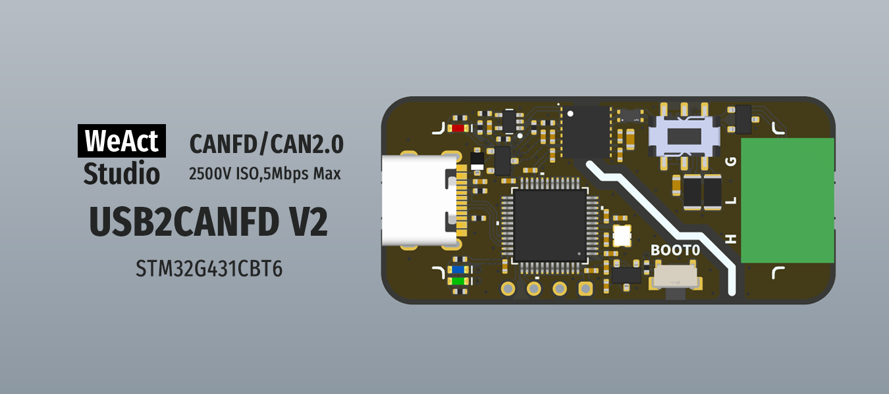

* [中文版本](./README_zh.md)
# WeActStudio.USB2CANFDV2

STM32G431CBT6  
> 170Mhz Max,32KB RAM,128KB ROM

CANFD/CAN2.0  
> 2500V isolation, 5Mbps Max, support cangaroo or secondary development. Transceiver part number: CA-IS2062A&Chipanalog

Connector  
> 3.81mm 1x3P WJ15EDGK-3.81-3P

## Firmware Description
**SLCAN Firmware(usb cdc)**
> Support [cangaroo](https://github.com/WeActStudio/cangaroo), source code: [WeActStudio.USB2CANFDV2.SLCAN_Firmware](https://github.com/WeActStudio/WeActStudio.USB2CANFDV2.SLCAN_Firmware.git)

**Candlelight2.5 Firmware(gs_usb)**
> Support [HUD-ECU-Hacker](https://netcult.ch/elmue/HUD%20ECU%20Hacker/), source code: [CANable-2.5-firmware-Slcan-and-Candlelight](https://github.com/WeActStudio/CANable-2.5-firmware-Slcan-and-Candlelight.git)

## SLCAN Protocol Description
> Please upgrade to the latest firmware version to support more baud rates

> Using the virtual serial, the command is as follows:
- `O[CR]` - Opens the CAN channel
- `C[CR]` - Close the CAN channel
- `S0[CR]` - Set the nominal bit rate to 10k
- `S1[CR]` - Set the nominal bit rate to 20k
- `S2[CR]` - Set the nominal bit rate to 50k
- `S3[CR]` - Set the nominal bit rate to 100k
- `S4[CR]` - Set the nominal bit rate to 125k (default)
- `S5[CR]` - Set the nominal bit rate to 250k
- `S6[CR]` - Set the nominal bit rate to 500k
- `S7[CR]` - Set the nominal bit rate to 800k
- `S8[CR]` - Set the nominal bit rate to 1M
- `S9[CR]` - Set the nominal bit rate to 83.3k
- `SA[CR]` - Set the nominal bit rate to 75k
- `SB[CR]` - Set the nominal bit rate to 62.5k
- `SC[CR]` - Set the nominal bit rate to 33.3k
- `SD[CR]` - Set the nominal bit rate to 5k
- `Sxxyy[CR]` - Custom nominal bit rate (60/2=30Mhz CAN clock) [xx=seg1(hex,0x02\~0xff), yy=seg2(hex,0x02\~0x80)]
- `Sddxxyy[CR]` - Custom nominal bit rate ([60/div]Mhz CAN clock) [dd=div(hex,0x01\~0xff), xx=seg1(hex,0x02\~0xff), yy=seg2(hex,0x02\~0x80)]
- `Y1[CR]` - Set the CANFD data segment bit rate to 1M
- `Y2[CR]` - Set CANFD data segment bit rate to 2M (default)
- `Y3[CR]` - Set the CANFD data segment bit rate to 3M
- `Y4[CR]` - Set the CANFD data segment bit rate to 4M
- `Y5[CR]` - Set the CANFD data segment bit rate to 5M
- `Yxxyy[CR]` - Custom CANFD data segment bit rate (60Mhz CAN clock) [xx=seg1(hex,0x01\~0x20), yy=seg2(hex,0x01\~0x10)]
- `Yddxxyy[CR]` - Custom CANFD data segment bit rate ([60/div]Mhz CAN clock) [dd=div(hex,0x01\~0x20), xx=seg1(hex,0x01\~0x20), yy=seg2(hex,0x01\~0x10)]
- `M0[CR]` - Set to normal mode, need close can channel (default)
- `M1[CR]` - Set to silent mode, need close can channel
- `A0[CR]` - Turn off automatic retransmission, need close can channel (default)
- `A1[CR]` - Enable automatic retransmission, need close can channel (not recommended, may crash)
- `tIIILDD...[CR]` - Transfer data frame (standard ID) [ID, length, data]
- `TIIIIIIIILDD...[CR]` - Transfer data frame (extended ID) [ID, length, data]
- `rIIIL[CR]` - Transfer remote frame (standard ID) [ID, length]
- `RIIIIIIIIL[CR]` - Transfer remote frame (extended ID) [ID, length]
- `dIIILDD...[CR]` - Transmit CANFD standard frames (without BRS enabled) [ID, length, data]
- `DIIIIIIIILDD...[CR]` - Transmit CANFD extended frames (without BRS enabled) [ID, length, data]
- `bIIILDD...[CR]` - Transmit CANFD standard frames (BRS enabled) [ID, length, data]
- `BIIIIIIIILDD...[CR]` - Transmit CANFD extended frames (BRS enabled) [ID, length, data]
- `0x80 + t, uint8_t length , uint16_t ID, uint8_t DLC, uint8_t *D...` - Transfer data frame (standard ID) [length, ID, DLC, Data] Enhance mode, length=ID+DLC+Data
- `0x80 + T, uint8_t length , uint32_t ID, uint8_t DLC, uint8_t *D...` - Transfer data frame (extended ID) [length, ID, DLC, Data] Enhance mode, length=ID+DLC+Data
- `0x80 + r, uint8_t length , uint16_t ID, uint8_t DLC` - Transfer remote frame (standard ID) [length, ID, DLC] Enhance mode, length=ID+DLC
- `0x80 + R, uint8_t length , uint16_t ID, uint8_t DLC` - Transfer remote frame (extended ID) [length, ID, DLC] Enhance mode, length=ID+DLC
- `0x80 + d, uint8_t length , uint16_t ID, uint8_t DLC, uint8_t *D...` - Transmit CANFD standard frames (without BRS enabled) [length, ID, DLC, Data] Enhance mode, length=ID+DLC+Data
- `0x80 + D, uint8_t length , uint32_t ID, uint8_t DLC, uint8_t *D...` - Transmit CANFD extended frames (without BRS enabled) [length, ID, DLC, Data] Enhance mode, length=ID+DLC+Data
- `0x80 + b, uint8_t length , uint16_t ID, uint8_t DLC, uint8_t *D...` - Transmit CANFD standard frames (BRS enabled) [length, ID, DLC, Data] Enhance mode, length=ID+DLC+Data
- `0x80 + B, uint8_t length , uint32_t ID, uint8_t DLC, uint8_t *D...` - Transmit CANFD extended frames (BRS enabled) [length, ID, DLC, Data] Enhance mode, length=ID+DLC+Data
- `V[CR]` - Reads the firmware version
- `E[CR]` - Read the failure state
- `X[CR]` - Enter firmware upgrade mode
- `H0[CR]` - Turn off SLCAN Enhance mode, need close can channel (default)
- `H1[CR]` - Turn on SLCAN Enhance mode, need close can channel
- `fIIIMMM[CR]` - Set standard ID filter, need close can channel [ID, mask] (default: 0,0)
- `FIIIIIIIIMMMMMMMM[CR]` - Set extended ID filter, need close can channel [ID, mask] (default: 0,0)

`[CR]` : `0x0D` (hex), `\r` (ascii)

**A status statement is returned after the command is sent**
- [CR]: transmission successful
- 0x07: transmission failed

**Note**  
The CANFD message length is as follows (in ascii, eg: `A`) (uint8_t DLC is hex, eg: `0x0A`):
- `0-8` : Same as standard CAN
- `9` : length = 12
- `A` : length = 16
- `B` : length = 20
- `C` : length = 24
- `D` : length = 32
- `E` : length = 48
- `F` : length = 64

**cangaroo is located in `Tools/cangaroo`**  
**The documentation for calculating custom Bitrate Settings is located in `Doc/CAN Bitrate Calculate_波特率计算.xlsx`**

## Pin Description
| pin | definition | specification |
|:--:|:--:| :--:|
|PA0|LED_RXD| Receive indicator, flashing when there is data |
|PA1|LED_TXD| Send indicator light, flashing when there is data |
|PA2|LED_READY| Status indicator, flashing 0.5S when the CAN port is opened(SLCAN Firmware) |
|PB9|FDCAN1_TX|FDCAN1 tx |
|PB8|FDCAN1_RX|FDCAN1 rx |
|PB7|FDCAN1_RX_EN|FDCAN1 rx enable, low active enable|
|PA12|USB_DP|USB 2.0 12Mbps|
|PA11|USB_DM|USB 2.0 12Mbps|
|PF0|OSC_IN|16Mhz XTAL|
|PF1|OSC_OUT|16Mhz XTAL|

## How to burn firmware
1. Press and hold the `BOOT0` key, then connect the device to your PC via a data cable.
2. Launch `STM32CubeProgrammer` and select the USB connection interface.
3. Import the firmware file and click the download button.
4. Restart the device after the download is completed.

## Catalog Description
| Directory name | content |
|:--:| :--:|
|Doc|Datasheet|
|Hardware| Hardware development data |
|Examples| Software routines |
|Tools| Tools|

```
/*---------------------------------------
- WeAct Studio Official Link
- taobao: weactstudio.taobao.com
- aliexpress: weactstudio.aliexpress.com
- github: github.com/WeActStudio
- gitee: gitee.com/WeActStudio
- blog: blog.weactstudio.com
---------------------------------------*/
```